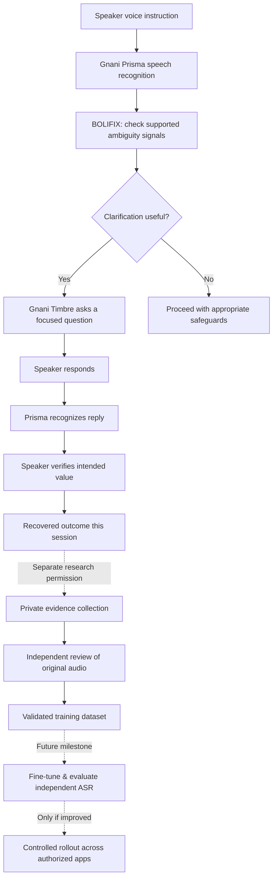

# BOLIFIX

### Recover now. Learn from verified corrections. Improve future voice AI.

**BOLIFIX is a voice-recovery and continual-learning layer for Indian-language applications.** A speech recognizer may misunderstand a quantity, name, or instruction. Before a voice app acts, BOLIFIX can flag supported risk signals, ask a focused spoken question, and let the **speaker confirm the intended meaning**.

With **separate permission**, recovery evidence can enter a private review process. Independently verified audio–transcript examples can support training and evaluation of an independent speech model, creating a path for future improvements across authorized applications.

**Current release:** a working *short-recording recovery prototype* with local review/evaluation infrastructure. Automatic learning, live phone-call streaming, cross-application sharing and proven model accuracy improvements are **not yet deployed**.

> **BOLIFIX is not another speech-to-text app. It helps fix consequential misunderstandings now, while building the verified evidence needed for future learning.**

## The problem

An Indian-language customer might say: **“Paanch nahi, pandrah packet chahiye”** — *“Not five. Fifteen packets.”*

If a voice system misunderstands the correction, it may process the wrong order. BOLIFIX can ask for the final quantity and seek speaker confirmation. This is an **illustrative example**, not a claim that Prisma made this exact mistake.

## How it works



**Loop 1 — Immediate recovery.** A confirmed value can be used in the present conversation. Confirming intent does **not** prove every word in the recording was transcribed correctly.

**Loop 2 — Verified learning.** Separately approved examples can be reviewed word-for-word, validated, and eventually used to train and test an independent model. BOLIFIX does **not** silently retrain Gnani Prisma.

## Implementation status

| Capability | Status |
|---|---|
| Live Gnani Prisma v3.0 transcription of permissioned short recordings | Implemented |
| Gnani Timbre v2.5 clarification and bounded spoken-reply flow | Implemented |
| Speaker-confirmed intended value and private session receipt | Implemented |
| Hindi/Hinglish number, negation and limited cross-script comparisons | Implemented with known coverage limits |
| Local Faster-Whisper Small second opinion | Exploratory; not an accuracy benchmark |
| Private evidence records, consent controls and independent human review | Local research tools |
| Dataset validation, speaker separation and evaluation utilities | Implemented |
| Real telephone-call streaming | Future integration |
| Fine-tuned model with proven gains on unseen speakers | Not completed |
| Multi-app/federated learning and automatic validated rollout | Future research |
| Public production-secure evidence database | Not implemented |

## Technology

**Python · FastAPI · Streamlit · SQLite · Gnani Prisma · Gnani Timbre · Faster-Whisper (optional)**

The application is designed so recognition providers can be compared without treating either one's output as guaranteed truth.

## Run locally

Use Python 3.11+ (project has been tested on Python 3.13), a private virtual environment and your own valid Gnani API credentials.

```powershell
python -m venv .venv
.\.venv\Scripts\Activate.ps1
python -m pip install -r requirements.txt
Copy-Item .env.example .env
# Set GNANI_API_KEY privately in your local .env
python -m streamlit run showcase_app.py
```

Open **http://localhost:8501**. Select **Voice Studio**, record a short instruction, approve processing, transcribe, and follow the speaker-verification flow.

The **public Showcase is session-only**. It does not automatically save recordings, enroll them for training or update model weights.

### Separate research interface

Start these in separate terminals:

```powershell
python -m uvicorn backend.main:app --reload --host 127.0.0.1 --port 8000
python -m streamlit run frontend/app.py
```

Research tools handle private evidence and reviews. **Never expose that local backend directly to the public internet.**

### Tests

```powershell
python -m pytest -q
```

Offline test success is not proof of higher ASR accuracy, secure public hosting or a trained improved model.

## Documentation

- [Call-to-learning architecture](CONTINUAL_LEARNING_BLUEPRINT.md)
- [Engineering plan](PROJECT_PLAN.md)
- [Safe deployment](DEPLOYMENT.md)
- [Demo video walkthrough](DEMO_VIDEO_SCRIPT.md)
- [Submission project description](SUBMISSION_TEXT.md)
- [Security and permissions](SECURITY.md)

## Privacy and evaluation principles

- Process only authorized recordings. Research/training requires **separate explicit permission**.
- Speaker-confirmed intent and independently verified word-for-word ground truth are distinct.
- A disagreement between models indicates potential risk; it does **not** prove one is wrong.
- Real improvement needs independent test data from unseen speakers. One approved recording is insufficient for a benchmark.
- Keep API keys, voice recordings, transcripts with personal data, local databases and model weights out of Git.
- Any use of provider-generated transcripts for model training must be allowed by the applicable provider agreement.

---

**Independent prototype built for the Great Indian AI Internship Challenge 2026. Not an official Gnani AI product.**
